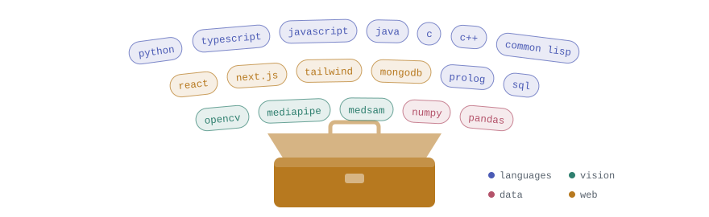

<picture>
  <source media="(prefers-color-scheme: dark)" srcset="assets/header-dark.svg">
  
</picture>

### Interests

- Robotics and vision-language-action models
- Computer vision
- AI for medical imaging

### Projects

- **[Probe](https://github.com/mashrufaorc/probe)**: tests whether tumour segmentation models still give the right clinical answer when the scanner changes.
- **[PosePhase](https://github.com/mashrufaorc/PosePhase)**: real-time exercise form analysis from a webcam.
- **[Parenthesis](https://github.com/mashrufaorc/parenthesis)**: a browser game for learning data structures. [Play it](https://cps305-quest.vercel.app)

### Skills

<picture>
  <source media="(prefers-color-scheme: dark)" srcset="assets/toolbox-dark.svg">
  
</picture>
